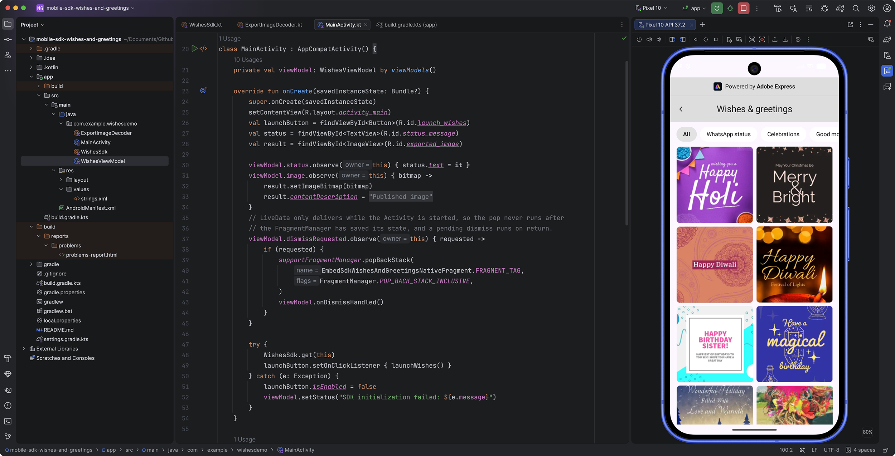
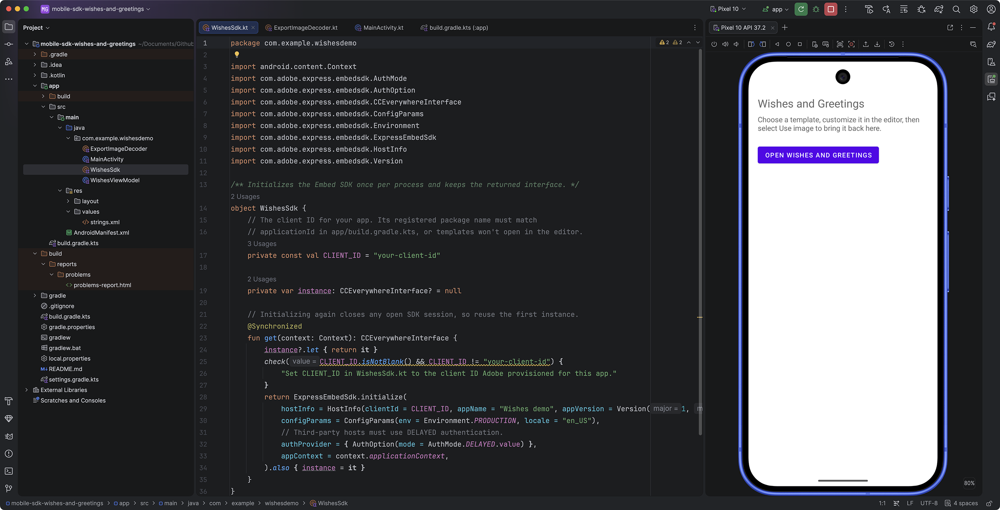
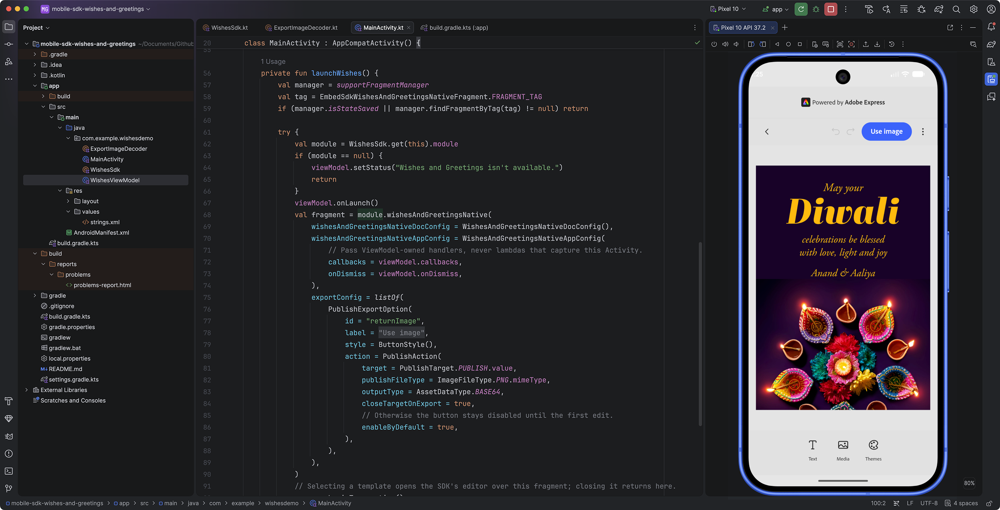
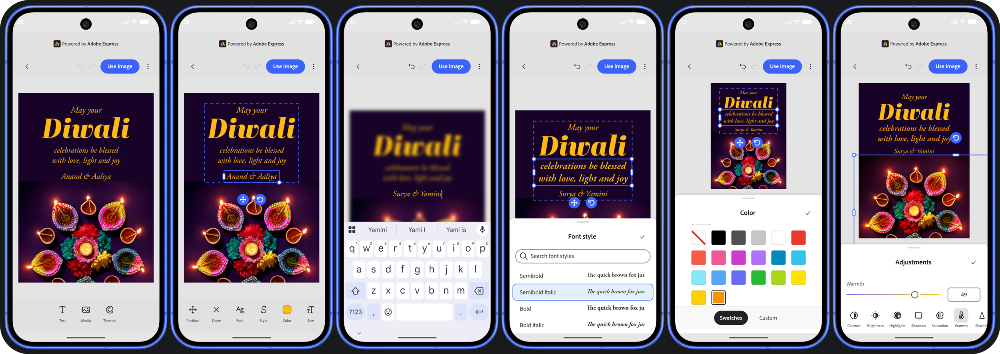
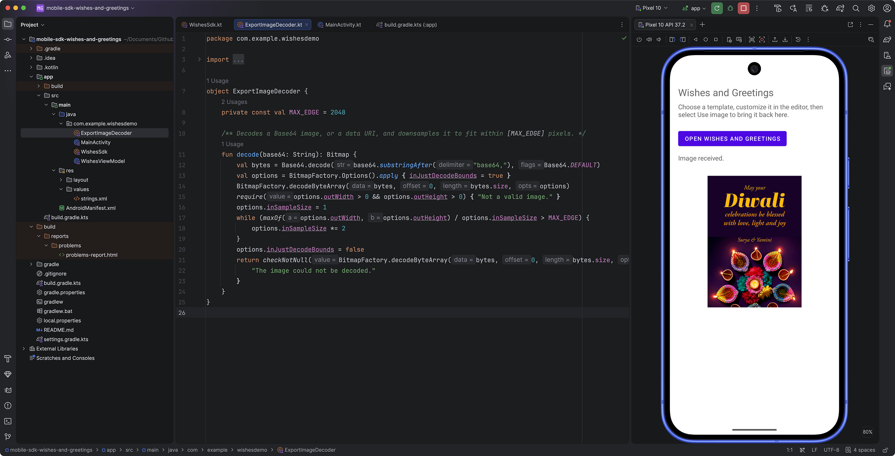

# Build a Wishes and Greetings integration with the Android Mobile SDK

This guide is for Android developers integrating the Wishes and Greetings module from the Embed Mobile SDK, which allows users to browse a collection of available templates, select and personalize one, and export it as an image back to your mobile app for sharing.



## Before you begin

### Prerequisites

This guide assumes you have a **good understanding of Android development and Kotlin programming**. You'll need to build a Kotlin Android app in Android Studio, and have a client ID for the Adobe Express Embed SDK.

<InlineAlert slots="text" variant="info" />

Obtain your **client ID** from Adobe's Developer Console, and ask Adobe to register your app's **package name** (its `applicationId`) for that client ID.

### Demo application

We have prepared an **Android demo application** that demonstrates the integration of the Wishes and Greetings module, whose screens and code will be used throughout this guide: you can access it [on GitHub here](https://github.com/AdobeDocs/embed-sdk-samples/tree/devex/airtel/code-samples/tutorials/mobile-sdk-wishes-and-greetings).

Use these settings for the tutorial host:

| Requirement       | Setting or preparation                                                                                                                              |
| ----------------- | --------------------------------------------------------------------------------------------------------------------------------------------------- |
| Android runtime   | Android 9 / API 28 or later; set `minSdk` to `28`                                                                                                   |
| Host Activity     | Extend `androidx.appcompat.app.AppCompatActivity` and use `supportFragmentManager`                                                                  |
| Compile SDK       | Use `compileSdk = 36`, matching the demo app; install Android SDK Platform 36                                                                       |
| Build tools       | Latest stable Android Studio and JDK 17 or later; the demo app uses Android Gradle Plugin 9, which compiles Kotlin without a separate Kotlin plugin |
| Android libraries | AppCompat, Activity KTX, and the Lifecycle ViewModel and LiveData libraries                                                                         |
| WebView           | Ensure an Android WebView provider is available; SDK initialization checks for it                                                                   |
| Network           | Allow internet access; the SDK declares the `INTERNET` and `ACCESS_NETWORK_STATE` permissions                                                       |
| Provisioning      | A client ID from Adobe, and your package name registered for it                                                                                     |

### Run the demo app

If you'd like to try the finished integration before building your own, run the [demo app](https://github.com/AdobeDocs/embed-sdk-samples/tree/devex/airtel/code-samples/tutorials/mobile-sdk-wishes-and-greetings) in Android Studio:

1. **Open the project.** Select **File > Open** and choose the `mobile-sdk-wishes-and-greetings` folder, the one that contains `settings.gradle.kts`, rather than the repository root. If prompted, select **Trust Project**.
2. **Check the Gradle JDK.** In **Settings** (**Android Studio > Settings** on macOS), go to **Build, Execution, Deployment > Build Tools > Gradle** and make sure **Gradle JDK** is version 17 or later. The JetBrains Runtime bundled with Android Studio works.
3. **Install Android SDK Platform 36.** In **Tools > SDK Manager**, on the **SDK Platforms** tab, select the Android 16 platform (API level 36) and select **Apply**.
4. **Set your identity values.** In `app/src/main/java/com/example/wishesdemo/WishesSdk.kt`, replace `your-client-id` with your client ID. In `app/build.gradle.kts`, set `applicationId` to the package name registered for it. Step 2 explains both values.
5. **Sync the project.** Select **File > Sync Project with Gradle Files**. The first sync needs internet access to download Gradle, the Android Gradle Plugin, and the SDK from Maven Central, and it creates `local.properties` with your Android SDK path. Sync again after you edit any `build.gradle.kts` file.
6. **Prepare a device.** Create an emulator in **View > Tool Windows > Device Manager** with a system image for API 28 or later. A **Google APIs** or **Google Play** image includes an up-to-date WebView. Alternatively, connect an Android 9 or later phone with **USB debugging** enabled.
7. **Run the app.** Select the **app** run configuration and your device in the toolbar, then select **Run > Run 'app'**.

<InlineAlert slots="text" variant="error" />

If sync fails because the Android Gradle Plugin version isn't supported, update Android Studio to the latest stable version. If Gradle reports `SDK location not found` when you build from the command line, open the project in Android Studio once so it creates `local.properties`, or set the `ANDROID_HOME` environment variable. The demo app's README lists more build fixes.

**Checkpoint:** the demo app opens on its host screen. Select **Open Wishes and Greetings**, pick a template, and select **Use image** to see the full flow that the rest of this guide builds.

### Understand the SDK and host boundary

The [Android Mobile SDK](https://github.com/AdobeDocs/express-embed-mobile-sdk-android-release) gives your existing app a Kotlin API for launching the Wishes and Greetings experience. Your host and the SDK have different responsibilities:

| Part of the flow      | SDK responsibility                                            | Your host responsibility                                               |
| --------------------- | ------------------------------------------------------------- | ---------------------------------------------------------------------- |
| Initialization        | Create the SDK interface from the supplied configuration      | Supply your application identity and retain the returned instance      |
| Browse                | Present categories and templates in the returned Fragment     | Mount that Fragment in an AppCompat Activity                           |
| Template selection    | Open the selected template in the editor                      | Keep the hosting Activity available; don't launch a second editor      |
| Publish               | Apply the export configuration and deliver callback data      | Read the asset, decode it, and update your UI                          |
| Dismiss               | Notify the host through `onDismiss` and the session callbacks | Remove the host-mounted browse Fragment at a lifecycle-safe point      |
| Configuration changes | Keep the callbacks and `onDismiss` for the whole session      | Make sure those handlers don't capture an Activity that gets recreated |

The distinction matters most at the end of the flow, as receiving an image and dismissing a screen are separate operations. You'll handle both without removing the editor from the publish callback.

## 1. Prepare the host screen

For the demo app, we've started with a simple screen that launches the Wishes and Greetings module and receives the result. We've kept the host UI small, although in real world scenarios you'll call the SDK from various points in your app.



1. Use an `AppCompatActivity` for the screen that owns the workflow.
2. In its layout, add a launch `Button`, a status `TextView`, and a result `ImageView`. The demo app uses `res/layout/activity_main.xml` with the IDs `launch_wishes`, `status_message`, and `exported_image`.
3. Create a `ViewModel` for the screen. In Step 4, it will own the SDK callbacks along with the status message and exported image they produce.

The launch code later in this guide replaces `android.R.id.content` and adds the browser transaction to the back stack. That lets the host screen remain the return destination. The result `ImageView` belongs to your host, not to the SDK Fragment.

**Checkpoint:** you have a host screen with a place to launch the workflow, report failures, and display the returned image. No SDK screen is open yet.

## 2. Install the Android SDK dependency

The SDK is published on Maven Central as `com.adobe.express.embed:embedsdk`. The [Android SDK installation README](https://github.com/AdobeDocs/express-embed-mobile-sdk-android-release) describes the installation steps: add the Maven dependency to your app module, sync Gradle, and import `ExpressEmbedSdk`. You don't need repository credentials.

<CodeBlock slots="heading, code" repeat="3" />

#### settings.gradle.kts

```kotlin-data-line="7"
// ...
dependencyResolutionManagement {
    repositoriesMode.set(RepositoriesMode.FAIL_ON_PROJECT_REPOS)
    repositories {
        google()
        // The Adobe Express Embed SDK is published on Maven Central.
        mavenCentral()
    }
}
```

#### app/build.gradle.kts

```kotlin-data-line="9,19"
// ...

android {
    namespace = "com.example.wishesdemo"
    compileSdk = 36

    defaultConfig {
        // Must match the package name Adobe registered for your client ID (see WishesSdk.kt).
        applicationId = "com.example.wishesdemo"
        minSdk = 28
        targetSdk = 35
        versionCode = 1
        versionName = "1.0"
    }
    // ...
}

dependencies {
    implementation("com.adobe.express.embed:embedsdk:1.1.1-beta")
    implementation("androidx.appcompat:appcompat:1.7.0")
    implementation("androidx.activity:activity-ktx:1.9.3")
    implementation("androidx.lifecycle:lifecycle-viewmodel-ktx:2.8.7")
    implementation("androidx.lifecycle:lifecycle-livedata-ktx:2.8.7")
    implementation("com.google.android.material:material:1.12.0")
}
```

#### src/main/java/com/example/wishesdemo/WishesSdk.kt

```kotlin-data-line="9"
package com.example.wishesdemo

// ...

object WishesSdk {
    // The client ID from the Adobe Developer Console for your app.
    // Its registered package name must match applicationId in
    // app/build.gradle.kts
    private const val CLIENT_ID = "your-client-id"

    // ...
}
```

1. Add `mavenCentral()` to `dependencyResolutionManagement.repositories` in `settings.gradle.kts`, if it isn't there already.
2. Add the SDK to the `dependencies` block of your app module's `build.gradle.kts`. Check the [GitHub Releases](https://github.com/AdobeDocs/express-embed-mobile-sdk-android-release/releases) page for the latest version.
3. Set `applicationId` to the package name Adobe registered for your client ID, and set `CLIENT_ID` to that client ID.
4. Sync the project in Android Studio and confirm that the `com.adobe.express.embedsdk.ExpressEmbedSdk` import resolves.

The two identity values must belong together:

| Value        | Where the demo app sets it                        | Must match                                           |
| ------------ | ------------------------------------------------- | ---------------------------------------------------- |
| Client ID    | `CLIENT_ID` in `WishesSdk.kt`, sent in `HostInfo` | The client ID Adobe issued for your app              |
| Package name | `applicationId` in `app/build.gradle.kts`         | The package name Adobe registered for that client ID |

### Keep the client ID out of source in production

To keep the tutorial short, the demo app stores the client ID as a constant in source. In a production app, inject it at build time instead, so each build variant or CI pipeline can supply its own value without editing code. For example, generate a `BuildConfig` field from a Gradle property:

```kotlin
// app/build.gradle.kts
android {
    buildFeatures { buildConfig = true }
    defaultConfig {
        buildConfigField("String", "EMBED_CLIENT_ID", "\"${providers.gradleProperty("embedClientId").getOrElse("")}\"")
    }
}
```

Set `embedClientId` in `~/.gradle/gradle.properties`, pass it with `-PembedClientId=…`, or supply it from your CI secrets, then read `BuildConfig.EMBED_CLIENT_ID` in place of the constant.

**Checkpoint:** Gradle resolves the SDK dependency, and your source can import `ExpressEmbedSdk`.

## 3. Initialize and retain the SDK

Initialization connects your app's identity and configuration to the SDK interface. The public entry point is `ExpressEmbedSdk.initialize`, which returns a `CCEverywhereInterface` synchronously. It isn't a JavaScript-style SDK loader or an initialization promise.

The helper uses these inputs:

| Input          | What you supply in this recipe                                               |
| -------------- | ---------------------------------------------------------------------------- |
| `hostInfo`     | Your client ID, and your host app's name and version                         |
| `configParams` | `Environment.PRODUCTION` and locale `en_US`                                  |
| `authProvider` | An `AuthOption` selecting `AuthMode.DELAYED`, required for third-party hosts |
| `appContext`   | The Android application context, not a retained Activity                     |

Add the initialization helper to `WishesSdk`:

<CodeBlock slots="heading, code" repeat="1" />

#### src/main/java/com/example/wishesdemo/WishesSdk.kt

```kotlin-data-line="8-13"
// ...
@Synchronized
fun get(context: Context): CCEverywhereInterface {
    instance?.let { return it }
    check(CLIENT_ID.isNotBlank() && CLIENT_ID != "your-client-id") {
        "Set CLIENT_ID in WishesSdk.kt to the client ID Adobe provisioned for this app."
    }
    return ExpressEmbedSdk.initialize(
        hostInfo = HostInfo(clientId = CLIENT_ID, appName = "Wishes demo", appVersion = Version(1, 0, 0)),
        configParams = ConfigParams(env = Environment.PRODUCTION, locale = "en_US"),
        // Third-party hosts must use DELAYED authentication.
        authProvider = { AuthOption(mode = AuthMode.DELAYED.value) },
        appContext = context.applicationContext,
    ).also { instance = it }
}
```

`Wishes demo` and `Version(1, 0, 0)` describe the demo app; replace them with your own app's name and version. `HostInfo` uses the mobile platform category by default. Use the environment that matches the client ID Adobe gave you; `ConfigParams` defaults to `Environment.PRODUCTION`, and the demo app sets it explicitly.

1. Call `WishesSdk.get` from your Activity's `onCreate`. Initializing again closes any open SDK session, so the helper returns the same instance on later calls, including after a rotation.
2. The `check` fails fast with a clear message if the client ID is still the placeholder.
3. Catch initialization exceptions, show them in the status view, and disable the launch button.

**Checkpoint:** the host retains one SDK interface and can report initialization failure without opening a broken workflow.

## 4. Connect the workflow callbacks

Before launching, create the `Callbacks` object that connects the SDK session to your host UI. You'll pass it, together with an `onDismiss` handler, when you launch the module in Step 5.

<InlineAlert slots="text" variant="warning" />

The SDK keeps the `callbacks` and `onDismiss` passed at launch for the whole session, including across configuration changes such as rotation. If they capture your Activity, they keep pointing at the destroyed instance after a rotation: the browser's back control stops closing the screen and a published image never appears. Define them in a `ViewModel`, which survives the configuration change, and let the current Activity observe it.

Use these hooks for this integration:

| Hook                | Host behavior                                                                                                |
| ------------------- | ------------------------------------------------------------------------------------------------------------ |
| `onLoadInit`        | Required by the `Callbacks` interface; a no-op is sufficient for this host                                   |
| `onCancel`          | Report that the session was cancelled rather than treating it as an image export                             |
| `onError`           | Show an actionable failure message with the error code                                                       |
| `onPublish`         | Record receipt of the publish event and start decoding the image                                             |
| `onSessionFinished` | After a publish event, request dismissal of the browse surface so the host result screen is revealed         |
| `onDismiss`         | Not part of `Callbacks`; passed separately in the app configuration. Request dismissal of the browse surface |

<CodeBlock slots="heading, code" repeat="1" />

#### src/main/java/com/example/wishesdemo/WishesViewModel.kt

```kotlin-data-line="12,23-27,30-32"
class WishesViewModel : ViewModel() {
    // ...
    @Volatile private var publishReceived = false

    fun onLaunch() {
        publishReceived = false
    }

    // ...

    // The SDK may invoke these off the main thread, so LiveData is updated with postValue.
    val onDismiss: () -> Unit = { _dismissRequested.postValue(true) }

    val callbacks: Callbacks = object : Callbacks {
        override var onLoadInit: LoadInitCallback = {}
        override var onLoadStart: LoadStartCallback? = null
        override var onLoad: LoadCallback? = null
        override var onPublishStart: PublishStartCallback? = null
        override var onEvent: EventCallback? = null
        override var onIntentChange: IntentChangeCallback? = null
        override var onWarmupComplete: WarmupCompleteCallback? = null

        override var onCancel: CancelCallback = { _, _ -> setStatus("Session cancelled.") }
        override var onError: ErrorCallback<Any>? = { error ->
            setStatus("SDK error: ${error.code} ${error.message}")
        }
        override var onPublish: PublishCallback? = { _, params -> handlePublish(params) }

        // Fires after the SDK closes its editor. After a publish, leave the browse screen too.
        override var onSessionFinished: SessionFinishedCallback? = {
            if (publishReceived) _dismissRequested.postValue(true)
        }
    }
    // ...
}
```

The ViewModel exposes three `LiveData` values that the Activity observes: `status`, `image`, and `dismissRequested`. The SDK can invoke callbacks off the main thread, so they update state with `postValue` instead of touching views.

The `publishReceived` flag is reset by `onLaunch()` before each launch and set when `onPublish` arrives. `onSessionFinished` uses it to decide whether to dismiss the browser. It records a publish event, not successful image decoding, so a missing or invalid image still produces a visible error message.

## 5. Configure and mount Wishes and Greetings

The workflow entry point is `sdk.module.wishesAndGreetingsNative`. It returns an `EmbedSdkWishesAndGreetingsNativeFragment`; your host mounts that Fragment.

The arguments divide the configuration into four concerns:

| Argument                            | Purpose in this flow                                                                      |
| ----------------------------------- | ----------------------------------------------------------------------------------------- |
| `wishesAndGreetingsNativeDocConfig` | Initial browse configuration; the default leaves `initialCategoryId` unset                |
| `wishesAndGreetingsNativeAppConfig` | Your callbacks and required `onDismiss` handler                                           |
| `exportConfig`                      | The editor's **Use image** PNG export action                                              |
| `containerConfig`                   | Editor hosting options; leave it unset for the default editor-over-browser path used here |

You don't need a category identifier to start. The default `WishesAndGreetingsNativeDocConfig()` uses `initialCategoryId = null`. If your integration later needs a preselected category, use an identifier supplied for that catalog rather than inventing one from its display label.

The app configuration also accepts `metaData`, `analyticsData`, and `appVersion`, which aren't needed here. It has a `colorTheme` parameter too, but the browse surface always uses a light theme and ignores it.

Add the launch function to your Activity:

<CodeBlock slots="heading, code" repeat="1" />

#### src/main/java/com/example/wishesdemo/MainActivity.kt

```kotlin-data-line="4,12,15-19,29-31,37-40"
private fun launchWishes() {
    val manager = supportFragmentManager
    val tag = EmbedSdkWishesAndGreetingsNativeFragment.FRAGMENT_TAG
    if (manager.isStateSaved || manager.findFragmentByTag(tag) != null) return

    try {
        val module = WishesSdk.get(this).module
        if (module == null) {
            viewModel.setStatus("Wishes and Greetings isn't available.")
            return
        }
        viewModel.onLaunch()
        val fragment = module.wishesAndGreetingsNative(
            wishesAndGreetingsNativeDocConfig = WishesAndGreetingsNativeDocConfig(),
            wishesAndGreetingsNativeAppConfig = WishesAndGreetingsNativeAppConfig(
                // Pass ViewModel-owned handlers, never lambdas that capture this Activity.
                callbacks = viewModel.callbacks,
                onDismiss = viewModel.onDismiss,
            ),
            exportConfig = listOf(
                PublishExportOption(
                    id = "returnImage",
                    label = getString(R.string.export_label),
                    style = ButtonStyle(),
                    action = PublishAction(
                        target = PublishTarget.PUBLISH.value,
                        publishFileType = ImageFileType.PNG.mimeType,
                        outputType = AssetDataType.BASE64,
                        closeTargetOnExport = true,
                        // Otherwise the button stays disabled until the first edit.
                        enableByDefault = true,
                    ),
                ),
            ),
        )
        // Selecting a template opens the SDK's editor over this fragment; closing it returns here.
        manager.beginTransaction()
            .replace(android.R.id.content, fragment, tag)
            .addToBackStack(tag)
            .commit()
    } catch (e: Exception) {
        viewModel.setStatus("Could not open Wishes and Greetings: ${e.message}")
    }
}
```

1. Connect your launch button to this function after SDK initialization succeeds.
2. The first guard skips the launch if the browser is already open, which prevents duplicate launches, or if the `FragmentManager` has already saved its state. It doesn't queue the launch; the user can tap again once the Activity resumes.
3. A `null` module or a launch exception is reported in the status view instead of failing silently.

<InlineAlert slots="text" variant="success" />

After a successful launch, you should see the Wishes and Greetings template browser in place of the host screen. The host remains its back-stack return destination.

## 6. Open a template in the SDK editor

When users select a template in the browser, the SDK carries the selected template identifier into its editor and forwards the export configuration you supplied at launch—this transition is part of the Wishes and Greetings workflow.



With `containerConfig` unset, the editor opens over the browse surface using the default content container. Keep the hosting Activity alive while the editor is active. The normal close path returns to the browser; your dismiss handling determines when to return from the browser to your own screen.

**Checkpoint:** selecting a template should open that design in the editor. You can personalize it there before returning the image to your host.

## 7. Edit the template

In the editor, your users can remix the template with the power and precision of Adobe Express' editing tools. They can add new text and media, or change text, images, colors, and other design elements provided by the template.



Additional tools may be introduced in future versions of the module. Currently, users can add or modify text and media, as well as customize the template’s color theme. For both new and existing elements, the editor provides a rich set of controls to fine-tune the design, such as font selection, size, format, color and style adjustment, layout, background removal, and much more!

Once they are satisfied with their edits, they can proceed clicking the "Use image" button, which triggers the `onPublish` callback.

## 8. Receive the published PNG

The launch function defines one export option. Its outer fields identify the UI action, and `PublishAction` defines the returned data:

| Field                 | Value in the demo app         | Meaning                                                 |
| --------------------- | ----------------------------- | ------------------------------------------------------- |
| `id`                  | `returnImage`                 | Identifier for this export option                       |
| `label`               | `Use image`                   | Button text shown for the action                        |
| `style`               | `ButtonStyle()`               | Button presentation using the default style             |
| `target`              | `PublishTarget.PUBLISH.value` | Deliver the result through the publish flow             |
| `publishFileType`     | `ImageFileType.PNG.mimeType`  | Request PNG output                                      |
| `outputType`          | `AssetDataType.BASE64`        | Request the image data as Base64                        |
| `closeTargetOnExport` | `true`                        | Close the editor after export                           |
| `enableByDefault`     | `true`                        | Enable the export action without requiring a first edit |

When users select **Use image** in the editor, the `onPublish` callback receives the intent and `PublishParams`. The payload contains a nullable `asset` list; it can also include `exportButtonId` and `documentId`. The export event is not itself a `Bitmap`.

The ViewModel's `onPublish` hands the parameters to `handlePublish`:

<CodeBlock slots="heading, code" repeat="1" />

#### src/main/java/com/example/wishesdemo/WishesViewModel.kt

```kotlin-data-line="3-6,11-20"
private fun handlePublish(params: PublishParams) {
    publishReceived = true
    val data = params.asset.orEmpty()
        .firstOrNull { it.dataType == AssetDataType.BASE64 }
        ?.getData()
        ?.takeIf { it.isNotBlank() }
    if (data == null) {
        setStatus("Publish returned no image.")
        return
    }
    viewModelScope.launch(Dispatchers.Default) {
        try {
            _image.postValue(ExportImageDecoder.decode(data))
            setStatus("Image received.")
        } catch (e: CancellationException) {
            throw e
        } catch (e: Exception) {
            setStatus("The returned image could not be displayed; try publishing again.")
        }
    }
}
```

1. Mark the publish event as received.
2. Pick the first asset with the `BASE64` data type you requested and a nonempty `getData()` value. If there isn't one, report it in the status view.
3. Decode the data off the main thread in `viewModelScope`, so decoding continues even if the Activity is recreated, then post the bitmap and status.
4. Rethrow `CancellationException` to preserve coroutine cancellation instead of reporting it as an image error.

## 9. Decode and display the image in your host

Keep image handling in the host rather than embedding it in SDK navigation. The demo app's `ExportImageDecoder` turns the Base64 payload into a `Bitmap` small enough to display:

<CodeBlock slots="heading, code" repeat="1" />

#### src/main/java/com/example/wishesdemo/ExportImageDecoder.kt

```kotlin-data-line="6-13"
object ExportImageDecoder {
    private const val MAX_EDGE = 2048

    /** Decodes a Base64 image, or a data URI, and downsamples it to fit within [MAX_EDGE] pixels. */
    fun decode(base64: String): Bitmap {
        val bytes = Base64.decode(base64.substringAfter("base64,"), Base64.DEFAULT)
        val options = BitmapFactory.Options().apply { inJustDecodeBounds = true }
        BitmapFactory.decodeByteArray(bytes, 0, bytes.size, options)
        require(options.outWidth > 0 && options.outHeight > 0) { "Not a valid image." }
        options.inSampleSize = 1
        while (maxOf(options.outWidth, options.outHeight) / options.inSampleSize > MAX_EDGE) {
            options.inSampleSize *= 2
        }
        options.inJustDecodeBounds = false
        return checkNotNull(BitmapFactory.decodeByteArray(bytes, 0, bytes.size, options)) {
            "The image could not be decoded."
        }
    }
}
```

1. Accept either raw Base64 or a data URI by taking the text after the `base64,` marker, if present.
2. Read the image bounds first, without allocating the full bitmap, and reject data that isn't a valid image.
3. Choose a power-of-two sample size so the longest edge is at most 2,048 pixels, then decode the bitmap.

The Activity observes the ViewModel and shows the result:

<CodeBlock slots="heading, code" repeat="1" />

#### src/main/java/com/example/wishesdemo/MainActivity.kt

```kotlin
viewModel.status.observe(this) { status.text = it }
viewModel.image.observe(this) { bitmap ->
    result.setImageBitmap(bitmap)
    result.contentDescription = getString(R.string.published_image)
}
```



Decoding starts when the publish callback arrives, even though the editor still covers the host screen. The image becomes visible when the workflow returns to that screen. Because the bitmap lives in the ViewModel, it's still there after a rotation.

## 10. Finish the session without racing navigation

Handle the end of the workflow in this order:

1. In `onPublish`, consume the data and start decoding. Don't pop the browser or remove the editor there.
2. Let the SDK close the editor, as requested by `closeTargetOnExport`.
3. In `onSessionFinished`, use the publish-received flag to request dismissal of the browse surface.
4. Pop the browser's tagged back-stack entry from the Activity when it observes the request.

The browse surface's own back control also calls `onDismiss`, which sends the same request, so the host is responsible for removing the browser in both cases. The Activity handles the request in one place:

<CodeBlock slots="heading, code" repeat="1" />

#### src/main/java/com/example/wishesdemo/MainActivity.kt

```kotlin-data-line="4-9"
// LiveData only delivers while the Activity is started, so the pop never runs after
// the FragmentManager has saved its state, and a pending dismiss runs on return.
viewModel.dismissRequested.observe(this) { requested ->
    if (requested) {
        supportFragmentManager.popBackStack(
            EmbedSdkWishesAndGreetingsNativeFragment.FRAGMENT_TAG,
            FragmentManager.POP_BACK_STACK_INCLUSIVE,
        )
        viewModel.onDismissHandled()
    }
}
```

Routing the dismissal through `LiveData` solves two lifecycle problems at once:

- **Saved state.** `LiveData` delivers values only while the Activity is started, so the back-stack pop never runs after the `FragmentManager` has saved its state. If the request arrives while the app is in the background, it's applied when the user returns.
- **Rotation.** The request is stored in the ViewModel, so the recreated Activity receives it.

Popping by tag is idempotent: if the browser's entry is no longer on the back stack, a repeated request does nothing, and it never pops unrelated entries.

<InlineAlert slots="text" variant="success" />

After a successful publish, decode, and return to the host, you should see the exported PNG in your result `ImageView` with **Image received.** in the status view. Cancellation or invalid image data should produce a status message instead, not a fabricated success image.

## Resolve common integration problems

Use the failing boundary to decide what to inspect:

| Symptom                                                                      | What to check                                                                                                                                                                                                 |
| ---------------------------------------------------------------------------- | ------------------------------------------------------------------------------------------------------------------------------------------------------------------------------------------------------------- |
| Gradle can't resolve the SDK dependency                                      | Confirm that `mavenCentral()` is in your `settings.gradle.kts` repositories and that the version exists on [GitHub Releases](https://github.com/AdobeDocs/express-embed-mobile-sdk-android-release/releases). |
| `ExpressEmbedSdk` or Wishes configuration types don't resolve                | Confirm that the dependency is in the app module and that the selected SDK version includes the Wishes and Greetings API.                                                                                     |
| The app reports that `CLIENT_ID` isn't set                                   | Replace the placeholder in `WishesSdk.kt` with the client ID Adobe issued for your app.                                                                                                                       |
| Initialization reports `WEB_VIEW_NOT_AVAILABLE`                              | Check that the Android environment has an available WebView provider. This check occurs before the SDK interface is returned.                                                                                 |
| Initialization reports `SDK_INITIALIZATION_IN_PROGRESS`                      | Ensure startup has one initialization owner and that another Activity or event handler isn't initializing concurrently.                                                                                       |
| The browser loads, but the editor never finishes loading                     | Check that `applicationId` matches the package name Adobe registered for your client ID, and that `AuthMode.DELAYED` is set.                                                                                  |
| A direct editor call reports `UNSUPPORTED_API`                               | Use the Wishes workflow's SDK-owned template transition instead of adding a direct third-party `editDesign` call.                                                                                             |
| After a rotation, the back control or **Use image** does nothing on the host | Make sure the `callbacks` and `onDismiss` passed at launch don't capture the Activity. Keep them in a ViewModel, as in Step 4.                                                                                |
| Publish returns no displayable data                                          | Handle a null or empty asset list and blank `getData()` values before decoding.                                                                                                                               |
| The browser remains after export                                             | Check your `onSessionFinished` handling and the `FRAGMENT_TAG` used for both the transaction and the pop.                                                                                                     |

When escalating a service failure, provide the SDK version, failing step, and sanitized callback error details through your approved partner support channel. Don't send exported image payloads as diagnostic logs, and don't substitute another app's client ID to work around an unexplained failure.

## What you integrated

You now have the integration boundaries for one complete Android flow:

1. Your app consumes the SDK from Maven Central and retains one initialized interface.
2. Your AppCompat Activity mounts the native Wishes and Greetings browser.
3. The SDK opens the selected template in its editor using the same workflow configuration.
4. Your ViewModel receives the published PNG, decodes it off the main thread, and exposes it to the Activity.
5. Your session and dismiss handlers return to the host safely, including across rotation, without removing the editor from `onPublish`.

For further lookup, use the [Android SDK API reference](https://adobedocs.github.io/express-embed-mobile-sdk-android-release/) for public classes, configuration, and callbacks, and the [Android SDK release list](https://github.com/AdobeDocs/express-embed-mobile-sdk-android-release/releases) for general release information.
