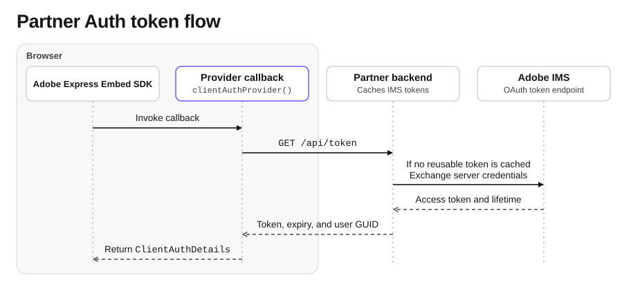
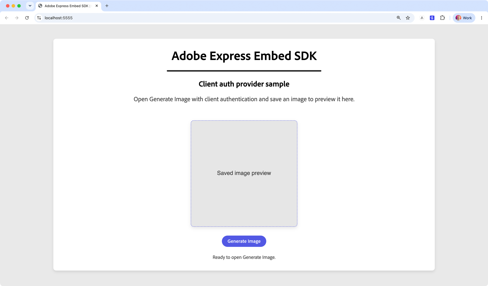

---
keywords:
  - Adobe Express
  - Embed SDK
  - Partner Auth
  - ClientAuthProvider
  - ClientAuthDetails
  - useClientAuth
  - Generative Credits
title: Embed SDK Centralized Generative Credits tutorial
description: Learn how to implement Partner Auth in the Adobe Express Embed SDK to centralize generative AI usage metering.
contributors:
  - https://github.com/undavide
---

# Embed SDK Centralized Generative Credits tutorial

Learn how to implement Partner Auth in the Adobe Express Embed SDK to centralize generative AI usage metering and draw from your partner's Generative Credits budget.

## How Partner Auth changes metering

When users of your integration use AI features that consume Generative Credits (for example, Generate Image, or Replace Object), the authentication model determines whose credits are used. By default, each user draws from their own monthly quota, which differs depending on whether they have a free or paid subscription plan.

With Partner Auth, the integration uses a client-based authentication model: usage draws from the partner's centralized Generative Credits budget, and not from the individual user's quota.

| Authentication model                       | Adobe ID sign-in                                                                                         | Generative Credits used                            |
| ------------------------------------------ | -------------------------------------------------------------------------------------------------------- | -------------------------------------------------- |
| Standard user-based authentication         | Each user signs in with their Adobe ID.                                                                  | Each user draws from their own monthly quota.      |
| Partner Auth (client-based authentication) | After Adobe enables Partner Auth for the integration, users may optionally not sign in with an Adobe ID. | Usage draws from the partner's centralized budget. |

<InlineAlert slots="text" variant="warning"/>

**Please note:** Partner Auth may be restricted to selected customers.

## How Partner Auth works

Implementing Partner Auth involves two parts: a **backend**, which mints and caches an access token from Adobe IMS using an OAuth server-to-server credential, and the **frontend** Embed SDK integration, which registers a callback to the backend and enables client authentication for the desired workflows



- **Your backend** keeps the client secret on the server. It exchanges the server-to-server credential for an Adobe IMS access token, caches the token, and supplies a stable identifier for the user from your own app.
- **The SDK** calls your browser-side provider, which fetches the token details from your backend. The SDK checks the returned details and calls the provider again before the reported expiry.

## Prerequisites

In this tutorial, you'll run a sample that adds Partner Auth to a Generate Image experience. You'll follow the token from your backend to the SDK and confirm that launching the module triggers a token request. For details on the image generation UI, customization, and export behavior, see the [Generate Image tutorial](./generate-image.md).

<InlineAlert variant="info" slots="text" />

Partner Auth works with the same mechanism outlined in this tutorial with other modules, including [Create Design](../concepts/ede-create-design.md) and [Edit Design](../concepts/ede-edit-design.md).

Before you start, make sure you have:

- Node.js 24.2 or later and basic JavaScript knowledge.
- An [Embed SDK API key](../quickstart/index.md#step-1-get-an-api-key) with `localhost:5555` in its [allowed domains](../quickstart/index.md#edit-the-list-of-allowed-domains). The API key and app name you pass in `hostInfo` are public and visible in the browser.
- A separate Adobe IMS OAuth server-to-server credential (client ID and client secret) with scopes approved for your integration. **Use this credential only on your backend to mint client access tokens.** Never put this client ID or secret in browser code.
- The required generative AI entitlements for your organization. Work with your Adobe representative to negotiate commercial terms. During onboarding, Adobe enables Partner Auth for your integration and provisions the entitlements for the technical account associated with your server-to-server credential.

## 1. Set up the sample project

Clone the [Adobe Express Embed SDK samples repository](https://github.com/AdobeDocs/embed-sdk-samples), then open `code-samples/tutorials/embed-sdk-client-auth-provider` from the repository root.

<InlineAlert slots="text" variant="success"/>

The sample project contains both the frontend and backend code needed to demonstrate Partner Auth with the Embed SDK. The `src` directory holds the browser-side code, while the `server` directory contains the server-side logic for exchanging and caching IMS tokens.

Add the secrets to the appropriate `.env` files as described below.

1. `src/.env`: set `VITE_API_KEY` to your public Embed SDK API key and `VITE_APP_NAME` to the **Public App Name** in the Adobe Developer Console. Vite exposes `VITE_*` values to the browser, so keep secrets out of this file!
2. `server/.env`: set `IMS_CLIENT_ID` and `IMS_CLIENT_SECRET` for your server-to-server credential, and set `IMS_SCOPE` to `openid,AdobeID,firefly_api,ff_apis`. `DEMO_USER_GUID` comes prepopulated for simplicity.
3. Run `npm install` from the sample directory.

To start the sample project, run `npm run dev` from the sample directory. This will start both the frontend and backend servers, allowing you to test the integration locally.

&lt;!-- atlas-non-sdk: terminal output from npm run dev --&gt;

```bash
$ npm run dev

> embed-sdk-client-auth-provider@1.0.0 dev
> concurrently --kill-others --names token,web "npm:server" "npm:start"

[token]
[token] > embed-sdk-client-auth-provider@1.0.0 server
[token] > node --env-file=server/.env server/server.js
[token]
[web]
[web] > embed-sdk-client-auth-provider@1.0.0 start
[web] > vite
[web]
[token] Token server listening on http://127.0.0.1:3000
[web]
[web]   VITE v8.4.0  ready in 197 ms
[web]
[web]   ➜  Local:   https://localhost:5555/
```

You can access the sample project browsing to the URL `https://localhost:5555/`.



## 2. Exchange and cache the IMS token on your server

You start at the server and work back to the launch button. At runtime, the order is reversed: the page registers the provider first, then your click opens the module and sets the token request in motion.

Open `server/server.js`. After the module loads, the SDK calls your provider, and Vite forwards the provider's `GET /api/token` to the Node.js server. With an empty cache, the handler uses the `client_credentials` grant to exchange its server-side credentials for an Adobe IMS access token.

<InlineAlert slots="text" variant="warning" />

`expires_in` needs to be converted from seconds to milliseconds and should report the token’s expiration time, capped at four minutes from the start of the exchange.

The handler sends JSON back to your provider in the shape of [`ClientAuthDetails`](../../v4/shared/src/types/client-authentication-types/interfaces/client-auth-details.md#properties). All three fields are required:

| Field                    | Type     | Value                                                                                       |
| ------------------------ | -------- | ------------------------------------------------------------------------------------------- |
| `clientAccessToken`      | `string` | The IMS access token.                                                                       |
| `tokenExpiryTimestampMs` | `number` | The reported expiry as an absolute Unix epoch timestamp in milliseconds, not a duration.    |
| `userGuid`               | `string` | A hyphenated UUID for the user. The sample reads its fixed demo UUID from `DEMO_USER_GUID`. |

Follow the handler's call to `getDetails()` to see how it gets that response:

&lt;!-- atlas-snippet: server-token-endpoint --&gt;

```js-data-line="25-32,48-50,56-63"
import { createServer } from "node:http";

const IMS_TOKEN_URL = "https://ims-na1.adobelogin.com/ims/token/v3";
const MAX_REPORTED_LIFETIME_MS = 4 * 60_000;
const CACHE_MARGIN_MS = 45_000;
const UUID = /^[0-9a-f]{8}(?:-[0-9a-f]{4}){3}-[0-9a-f]{12}$/i;

export function createTokenServer({
  clientId,
  clientSecret,
  scope,
  userGuid,
  fetchIms = fetch,
  now = Date.now,
}) {
  if (!clientId || !clientSecret || !scope || !UUID.test(userGuid ?? "")) {
    throw new Error("Configure the IMS credentials, scope, and demo user UUID.");
  }

  let cached;
  let inFlight;

  async function mintToken() {
    const requestedAt = now();
    const response = await fetchIms(IMS_TOKEN_URL, {
      method: "POST",
      body: new URLSearchParams({
        client_id: clientId,
        client_secret: clientSecret,
        grant_type: "client_credentials",
        scope,
      }),
      redirect: "error",
      signal: AbortSignal.timeout(10_000),
    });
    if (!response.ok) {
      await response.body?.cancel();
      throw new Error("IMS token exchange failed.");
    }

    const { access_token, expires_in } = await response.json();
    if (typeof access_token !== "string" || !access_token ||
        !Number.isFinite(expires_in) || expires_in <= 0) {
      throw new Error("Invalid IMS token response.");
    }

    // Measure from request start so exchange latency can't extend the deadline.
    const tokenExpiryTimestampMs = requestedAt +
      Math.min(expires_in * 1_000, MAX_REPORTED_LIFETIME_MS);
    if (tokenExpiryTimestampMs <= now()) {
      throw new Error("IMS token expired during the exchange.");
    }
    return { clientAccessToken: access_token, tokenExpiryTimestampMs, userGuid };
  }

  async function getDetails() {
    if (cached && cached.tokenExpiryTimestampMs - now() > CACHE_MARGIN_MS) {
      return cached;
    }
    inFlight ??= mintToken()
      .then((details) => (cached = details))
      .finally(() => { inFlight = undefined; });
    return inFlight;
  }

  return createServer(async (request, response) => {
    response.setHeader("Content-Type", "application/json");
    response.setHeader("Cache-Control", "no-store");
    // This local-only check is not user authorization.
    if (request.headers.host !== `127.0.0.1:${request.socket.localPort}` ||
        request.headers["sec-fetch-site"] === "cross-site") {
      response.writeHead(403).end(JSON.stringify({ error: "Forbidden" }));
      return;
    }
    if (request.method !== "GET" || request.url !== "/api/token") {
      response.writeHead(404).end(JSON.stringify({ error: "Not found" }));
      return;
    }

    try {
      const details = await getDetails();
      response.end(JSON.stringify(details));
    } catch {
      response.writeHead(503).end(JSON.stringify({ error: "Token unavailable" }));
    }
  });
}

if (import.meta.main) {
  createTokenServer({
    clientId: process.env.IMS_CLIENT_ID,
    clientSecret: process.env.IMS_CLIENT_SECRET,
    scope: process.env.IMS_SCOPE,
    userGuid: process.env.DEMO_USER_GUID,
  }).listen(3000, "127.0.0.1", () => {
    console.log("Token server listening on http://127.0.0.1:3000");
  });
}
```

Reuse an issued token instead of requesting a new one for every `/api/token` call. On each later request, the sample returns its in-memory cached response if more than 45 seconds remain before the reported expiry. Otherwise, it requests a fresh token, sharing one IMS exchange across concurrent requests. If that exchange fails or times out, the handler returns a generic HTTP `503` without exposing IMS details or retrying within the request. Please note, the cache, 45-second margin, and four-minute cap are sample choices, not SDK requirements.

<InlineAlert slots="text" variant="hearer, info"/>

#### Token Expiry

IMS access tokens last **24 hours** by default. For production, ask your Adobe representative to shorten the lifetime of tokens to **five minutes**. Please note: reporting an earlier timestamp to the SDK doesn't shorten the validity of the IMS token, and would represent a security risk.

## 3. Fetch the token from the browser

When the Generate Image module finishes loading, the SDK calls `clientAuthProvider()` to get the details it needs to pass to the module. Open `src/client-auth-provider.js`. A [`ClientAuthProvider`](../../v4/shared/src/types/client-authentication-types/interfaces/client-auth-provider.md) takes no arguments and returns a promise that resolves to `ClientAuthDetails`.

On each call, your provider fetches the same-origin `/api/token` route. Vite proxies that request to the server from step 2 at `127.0.0.1:3000`. Follow the callback from the fetch to either the three returned fields or an error that leaves out the response body:

&lt;!-- atlas-snippet: browser-client-auth-provider --&gt;

```js-data-line="2,16"
export async function clientAuthProvider() {
  const response = await fetch("/api/token", { cache: "no-store" }).catch(() => {
    throw new Error("Token endpoint unavailable.");
  });
  if (!response.ok) {
    throw new Error(`Token endpoint returned HTTP ${response.status}.`);
  }

  const { clientAccessToken, tokenExpiryTimestampMs, userGuid } =
    (await response.json().catch(() => null)) ?? {};
  if (typeof clientAccessToken !== "string" || !clientAccessToken ||
      !Number.isFinite(tokenExpiryTimestampMs) ||
      typeof userGuid !== "string" || !userGuid) {
    throw new Error("Invalid token endpoint response.");
  }
  return { clientAccessToken, tokenExpiryTimestampMs, userGuid };
}
```

The SDK validates the details before handing them to the module. It rejects a reported expiry at or before its current time or more than five minutes ahead. When Adobe has enabled Partner Auth for your integration, the module uses the token for generative features, with usage metered to the partner.

With the module open, the SDK calls your provider again about 30 seconds before the reported expiry. If that token is still in the sample server's cache, the request falls inside the server's 45-second cache margin, so the server exchanges with IMS for a fresh token instead of reusing the expiring one.

If the provider throws, rejects, or returns invalid details, the SDK reports `CLIENT_AUTH_PROVIDER_ERROR`. After a failed scheduled refresh, the SDK waits one minute before retrying and stops the refresh loop after three consecutive failures.

## 4. Register the provider with the SDK

On page load, `src/main.js` builds `hostInfo` from your browser settings, loads the SDK from the Adobe CDN, then calls `initializeClientAuth()`. Open `src/initialize-client-auth.js` to see what the helper passes to [`initialize()`](../../v4/sdk/src/3p/cc-everywhere/variables/default.md#initialize). The third argument keeps user sign-in delayed; it doesn't turn sign-in off. The fourth registers `clientAuthProvider` for later:

&lt;!-- atlas-snippet: initialize-client-auth --&gt;

```js-data-line="8-9"
import { clientAuthProvider } from "./client-auth-provider.js";

export function initializeClientAuth(CCEverywhere, hostInfo) {
  const configParams = { locale: "en-US" };
  return CCEverywhere.initialize(
    hostInfo,
    configParams,
    { mode: "delayed" },
    clientAuthProvider,
  );
}
```

The SDK stores your callback without calling it, so the page makes no `/api/token` request during setup. When `initialize()` resolves, `src/main.js` uses the SDK instance to bind the **Generate Image** button, then enables it. The sample repeats this setup when you reload the page.

## 5. Opt Generate Image into client authentication

After initialization, `src/main.js` calls `bindTextToImage()` to wire up the button. Open `src/launch-text-to-image.js`. Each time you click **Generate Image**, the handler opens the module by calling `module.createImageFromText()` with `appConfig` as its first argument. The `useClientAuth: true` flag opts this launch in: when the module loads, the SDK starts the refresh loop by calling the provider from step 3.

Trace the highlighted lines from the opt-in flag to the launch call:

&lt;!-- atlas-snippet: launch-text-to-image --&gt;

```js-data-line="6,43"
export function bindTextToImage(button, sdk, preview, onError) {
  const { module } = sdk;
  let previewUrl;
  const appConfig = {
    // Let this module request the client token from your provider.
    useClientAuth: true,
    appVersion: "2",
    featureConfig: {
      "community-wall": true,
      "fast-mode": false,
      "custom-models": false,
    },
    promptInputPlaceholder: "A lighthouse on a rocky coast at sunrise",
    callbacks: {
      onPublish(_intent, publishParams) {
        const data = publishParams?.asset?.[0]?.data;
        if (!(typeof data === "string" && data) && !(data instanceof Blob)) return;
        const previousUrl = previewUrl;
        previewUrl = data instanceof Blob ? URL.createObjectURL(data) : undefined;
        preview.src = previewUrl ?? data;
        preview.alt = "Saved image";
        if (previousUrl) URL.revokeObjectURL(previousUrl);
      },
      onError: () => onError(),
    },
  };
  const exportConfig = [
    {
      id: "download",
      label: "Download",
      action: { target: "download" },
      style: { uiType: "button" },
    },
    {
      id: "save-modified-asset",
      label: "Save image",
      action: { target: "publish" },
      style: { uiType: "button" },
    },
  ];
  button.addEventListener("click", () => {
    try {
      module.createImageFromText(appConfig, exportConfig);
    } catch {
      onError();
    }
  });
}
```

<InlineAlert slots="text" variant="warning"/>

In order for the client authentication provider to function correctly, **you need both pieces.** Registering the provider alone doesn't opt Generate Image in: without the flag, the SDK doesn't start the refresh loop for this launch. If you set the flag but don't register a provider, the SDK reports `CLIENT_AUTH_PROVIDER_ERROR` when it tries to fetch the details, not during `initialize()`.

## 6. Run the app and confirm the token request

1. If the servers from step 1 aren't running, make sure ports `5555` and `3000` are free, then run `npm run dev` from the sample directory. The command starts both the Vite app and the Node.js token server. In the terminal, look for the Vite URL and the token server's listening message.
2. Open the **Network** panel in your browser's developer tools, then load `https://localhost:5555`. The sample serves HTTPS with a local development certificate from `vite-plugin-mkcert`. On first run, your OS might prompt for your password to trust the local development certificate authority (CA). After that, your browser trusts `https://localhost:5555`.
3. As the page loads, look for the SDK assets from the CDN. There's no `/api/token` request yet. When `initialize()` resolves, the page shows **Ready to open Generate Image.** and enables the Spectrum **Generate Image** button.
4. Click **Generate Image**. The module loads, then your provider sends a same-origin `GET /api/token` request. Check the status without copying the response body, which contains an access token.

<InlineAlert slots="text" variant="success" />

You should see HTTP `200` for `/api/token` after launch. This confirms your provider reached the token server. It doesn't verify hosted sign-in behavior, image generation, export, token consumption, or credit metering.

If you leave the module open, you can also watch for the scheduled refresh. When the four-minute cap sets the reported expiry, the sample settings put the next scheduled `GET /api/token` roughly three and a half minutes after the first IMS exchange starts. That's the sample's cap minus the SDK's roughly 30-second lead time, not a fixed interval.

<InlineAlert slots="text" variant="warning" />

If the browser reports a `frame-ancestors` violation, confirm you're using `https://localhost:5555` and that `localhost:5555` is in your API key's allowed domains. The embedded module must allow your serving origin to frame it. A local certificate doesn't add the origin to the allowlist.

## Secure your token endpoint

Keep the client secret on your server. The client access token reaches the browser, so treat it as exposed. Keep the token's actual lifetime short; see the five-minute token guidance in [step 2](#2-exchange-and-cache-the-ims-token-on-your-server).

In production, serve the token endpoint over HTTPS and protect it with your app's own authentication and authorization. Only users who are signed in to your app and using your embedded experience should be able to get tokens. For the sake of this tutorial, the local demo endpoint doesn't perform these user checks.

## Next steps

You've connected the token server, the browser provider, and the Generate Image launch. Create a stable UUID with no personal information for each user, store it with their user record, and return the same UUID across sessions and token refreshes. The SDK checks the format; your integration keeps the identifier stable.
